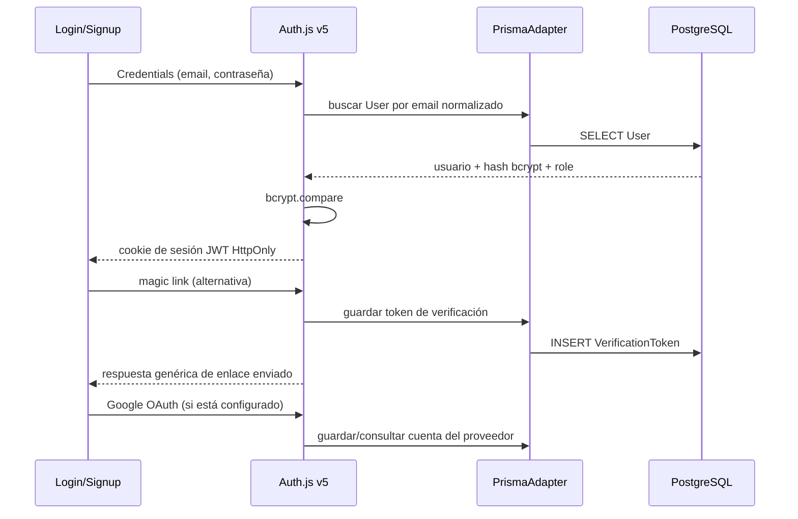
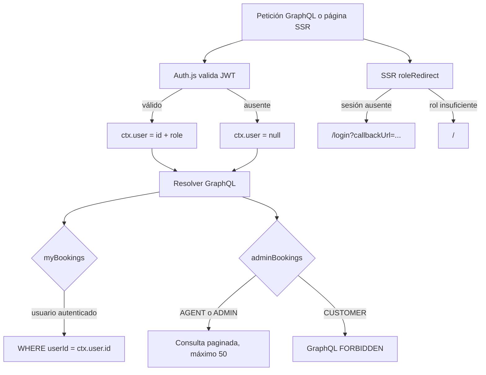

# Fase 2 — Autenticación y roles

## Estado

| Actividad | Estado | Implementación |
|---|---|---|
| 2A — Auth.js v5, Prisma Adapter, Credentials y magic link | ✅ | `server/auth.ts` y `pages/api/auth/[...nextauth].ts` |
| 2B — JWT con `id`/`role` y `ctx.user` | ✅ | Callbacks de Auth.js y `server/context.ts` |
| 2C — Query `me` y sesión en frontend | ✅ | `server/modules/auth.ts`, `features/auth/useMe.ts`, `SessionProvider` |
| 2D — Guards de rol backend/frontend | ✅ | `server/auth-guards.ts`, `features/auth/RequireRole.tsx`, SSR redirects |
| 2E — Página “Mis reservas” | ✅ | `pages/mis-reservas.tsx`, filtrado por `ctx.user.id` |
| Google OAuth opcional | ✅ | `server/auth.ts`, `features/auth/GoogleSignInButton.tsx`; requiere configurar credenciales |
| Gestión de paquetes | Código listo; despliegue de la app pendiente | `pages/admin/paquetes.tsx`, `server/modules/promo-packages.ts`; migración y seis datos iniciales aplicados en la base de producción seleccionada |

Se añadió también una vista de operaciones en `/admin`. En el Pages Router no hay un convenio de layouts por archivo como `pages/admin/_layout.tsx`; el layout protegido vive en `features/auth/AdminLayout.tsx` y se consume desde `pages/admin/index.tsx`.

## Flujo de inicio de sesión



En desarrollo, Nodemailer usa `jsonTransport` y el enlace de acceso se imprime en la terminal de Next con el formato `🔗 Magic link para <email>: <url>`. Ese enlace es un secreto de un solo uso: no lo compartas ni lo guardes en logs persistentes. En producción es obligatorio definir un transporte real.

Google solo se registra como proveedor cuando `AUTH_GOOGLE_ID` y
`AUTH_GOOGLE_SECRET` están presentes; las páginas de acceso muestran el botón
bajo la misma condición. La aplicación falla explícitamente si solo una de las
dos variables está configurada.

Para activarlo:

1. En Google Cloud Console, configura la pantalla de consentimiento OAuth y
   crea un cliente OAuth de tipo **Aplicación web**.
2. Añade el dominio de la app como origen autorizado y
   `https://<dominio>/api/auth/callback/google` como URI de redirección
   autorizada. Para probar un Preview, registra también el dominio exacto de
   ese deployment y su callback.
3. En Vercel, configura `AUTH_GOOGLE_ID` y `AUTH_GOOGLE_SECRET` como variables
   de entorno para los entornos que correspondan y vuelve a desplegar. No
   compartas ni guardes el secreto en el repositorio.
4. Si la pantalla de consentimiento está en modo de prueba, agrega las cuentas
   que iniciarán sesión como usuarios de prueba.

Este flujo es OAuth para iniciar sesión; no requiere habilitar APIs adicionales
de Google ni solicitar scopes aparte del perfil básico de identidad. No actives
el enlace automático de cuentas por email: una cuenta local con el mismo correo
debe autenticarse por su método existente antes de vincular identidades. El rol
de una cuenta Google nueva proviene del valor por defecto de `User.role`
(`CUSTOMER`), nunca de datos del perfil de Google.

## Flujo de autorización y reservas



La UI añade un guard cliente para evitar mostrar contenido durante la navegación, pero la decisión de seguridad se vuelve a tomar en el servidor. `createManualHotel` exige `ADMIN`; `adminBookings` permite `AGENT` y `ADMIN`, y ofrece filtros con paginación cursorada; `myBookings` requiere sesión y siempre filtra por la identidad confiable del contexto. La reserva de invitado (`createBooking`) sigue disponible.

## Paquetes promocionales

`/admin/paquetes` está limitado en SSR y en GraphQL a `ADMIN` y `AGENT`.
`/admin/combos` ya no es una ruta válida. Los paquetes actuales usan imágenes
locales de `public/`, así que consultarlos y publicarlos no requiere configurar
un servicio de almacenamiento externo. La migración y el importador se
ejecutaron en la base de producción configurada: hay seis paquetes publicados
con imágenes locales. En otros entornos, aplica la migración y ejecuta
`npm run packages:seed`; el comando es idempotente y no sobrescribe registros.

El store actual es privado. Conecta `aleca-travel-blob` al proyecto Vercel en
Preview y Production y habilita la variable estándar
`BLOB_READ_WRITE_TOKEN` para la conexión: el SDK la necesita para firmar los
tokens de carga directa desde el navegador. Vercel configura
`BLOB_STORE_ID`/OIDC para lecturas server-side; para desarrollo local, conecta
también el entorno Development y usa `vercel env pull` sin compartir ni
commitear el archivo de variables. Si falta `BLOB_READ_WRITE_TOKEN`, la lista
sigue funcionando y el formulario de carga se deshabilita con un mensaje.

Los flyers suben con acceso privado. La web no expone el URL privado del Blob:
una API del mismo origen lee el objeto con el SDK y permite acceso público solo
para paquetes publicados dentro de sus fechas; los borradores requieren sesión
ADMIN/AGENT. Por ello, no se necesita permitir que el navegador lea directamente
el dominio privado de Blob.

El alta crea `PromoPackage` en estado borrador o publicado. Solo los publicados
dentro de su ventana de fechas aparecen en la portada; el catálogo de hoteles
no se modifica. La mutación Pothos vuelve a validar campos, precio, fechas y
que URL/ruta privada de imagen coincidan. La migración
`prisma/migrations/20261112120000_add_promo_packages/` debe desplegarse en cada
entorno antes de usar la lista o importar registros. La aplicación aún no
ofrece edición de metadatos ni eliminación de blobs.

## Credenciales de datos semilla

`prisma/seed.ts` asigna el mismo hash bcrypt de costo 10 a las cuentas de demostración:

| Rol | Email | Contraseña local |
|---|---|---|
| ADMIN | `admin@agencia.test` | `password123` |
| AGENT | `agente@agencia.test` | `password123` |
| CUSTOMER | clientes `@example.com` creados por el seed | `password123` |

Estos datos son solo para desarrollo y pruebas. No reutilices esas credenciales en producción. El seed actual vacía y vuelve a poblar las tablas de la aplicación; **no ejecutes `npm run seed` en una base de datos con datos que quieras conservar**.

## Configuración de entorno

Auth.js v5 utiliza `AUTH_SECRET` para firmar y cifrar cookies. Genera un secreto nuevo por entorno; no lo incluyas en documentación, commits ni logs. Para desplegar detrás de un proxy, configura `AUTH_TRUST_HOST=true` solo si el proxy/hosting valida el host entrante.

En producción configura además:

```dotenv
AUTH_SECRET=<secreto-aleatorio-del-entorno>
AUTH_TRUST_HOST=true
EMAIL_SERVER=smtp://<usuario>:<contraseña>@<servidor>:587
EMAIL_FROM=Aleca Travel <no-reply@tu-dominio.example>
AUTH_GOOGLE_ID=<id-de-cliente-oauth>
AUTH_GOOGLE_SECRET=<secreto-de-cliente-oauth>
BLOB_READ_WRITE_TOKEN=<token-de-vercel-blob>
```

`EMAIL_SERVER` no se exige para el transporte local de desarrollo; si se solicita un magic link en producción sin transporte configurado, la petición falla explícitamente. Mantén los valores reales únicamente en el gestor de secretos del despliegue. El proveedor local no envía emails.

## Validación

```bash
npx tsc --noEmit
npm run graphql:sync
npm test -- tests/auth.test.ts tests/booking-auth.test.ts
npm test -- tests/promo-packages.test.ts tests/safe-callback-url.test.ts
npm test
```

Las pruebas de integración usan Yoga local y una sesión inyectada en el contexto; no llaman al endpoint HTTP de Auth.js. Crean usuarios/reservas efímeros en la base `DATABASE_URL` del entorno de tests y limpian en `finally`. No truncan ni repueblan datos. Revisa que `DATABASE_URL` apunte a una base de pruebas/desarrollo antes de ejecutarlas.

Cobertura añadida:

- costo/hash bcrypt, verificación de password válido/incorrecto y límites UTF-8;
- registro con email normalizado, rol por defecto, hash persistido y conflicto por duplicado;
- autorización de Credentials con email normalizado y rechazo de credenciales incorrectas;
- `me` anónimo y con los tres roles;
- mapeo de la sesión y guardas `UNAUTHENTICATED`/`FORBIDDEN`;
- aislamiento de `myBookings`, autorización de `adminBookings` y vínculo de reserva a `ctx.user.id`;
- permisos de paquetes para ADMIN/AGENT, denegación para CUSTOMER/anónimos y validación de URL/ruta de Blob;
- validación de que la URL/ruta de un flyer debe pertenecer al store privado de Blob;
- destinos de retorno de Google limitados a rutas relativas del mismo origen.

## Decisiones y límites

- Se mantiene JWT, como requiere Credentials. El adaptador se usa para usuarios, cuentas y tokens de magic link; no para persistir sesiones activas en la tabla `Session`.
- El esquema ya incluía los modelos del adaptador y el campo nullable `User.password`, por eso no se necesitó una migración en esta tarea.
- El proveedor Nodemailer local imprime enlaces de autenticación según el requisito del proyecto. Los logs deben ser efímeros y de acceso restringido.
- Antes de producción, añade limitación de intentos para login/registro y protección antiabuso con un servicio compartido (no un contador en memoria que se reinicia por instancia).
- No se añadió recuperación de contraseña, revocación inmediata de JWT, MFA ni confirmación adicional al registro; son trabajos posteriores.
